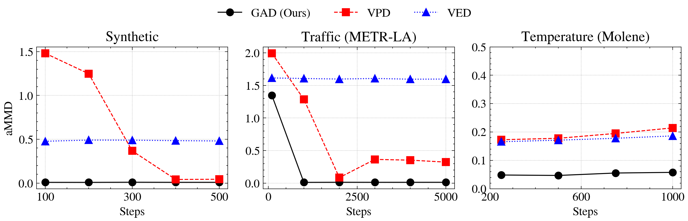

# Graph-Aware Diffusion for Signal Generation

by
Sergio Rozada,
Vimal K. B.,
Andrea Cavallo,
Antonio G. Marques,
Hadi Jamali-Rad,
and Elvin Isufi

This code belongs to the paper [*Graph-Aware Diffusion for Signal Generation*](https://arxiv.org/abs/2510.05036).

## TLDR

> This paper proposes a graph-aware generative diffusion model (GAD) for graph signals, whose forward process is driven by the heat equation on the graph and converges to a Gaussian Markov random field with covariance parametrized by the graph Laplacian.

    

## Abstract

> We study the problem of generating graph signals from unknown distributions defined over given graphs, relevant to domains such as recommender systems or sensor networks. Our approach builds on generative diffusion models, which are well established in vision and graph generation but remain underexplored for graph signals. Existing methods lack generality, either ignoring the graph structure in the forward process or designing graph-aware mechanisms tailored to specific domains. We adopt a forward process that incorporates the graph through the heat equation. Rather than relying on the standard formulation, we consider a time-warped coefficient to mitigate the exponential decay of the drift term, yielding a graph-aware generative diffusion model (GAD). We analyze its forward dynamics, proving convergence to a Gaussian Markov random field with covariance parametrized by the graph Laplacian, and interpret the backward dynamics as a sequence of graph-signal denoising problems. Finally, we demonstrate the advantages of GAD on synthetic data, real traffic speed measurements, and a temperature sensor network.

## Software implementation

All source code used to generate the results and figures in the paper is in the `src` folder:

* `src/sde.py`: Graph-aware (GAD), variance-preserving (VPD) and variance-exploding (VED) SDEs.
* `src/models.py`: Graph-filter (GNN) and MLP denoisers.
* `src/metrics.py`: Graph-signal metrics (total variation, spectral centroid, degree correlation) and MMD.
* `src/trainer.py`: Denoiser training and reverse-time Euler-Maruyama sampling.
* `src/experiments`: SBM, METR-LA and Molene experiments.
* `src/plots`: Figure generation.

The calculations and figure generation are all done by running:

* `main.py`: Runs all the experiments, stores the data, and plots the figures.

The experiments compare GAD against VPD and VED in terms of the average MMD (aMMD) between real and generated signals as a function of the number of discretization steps, on a synthetic stochastic block model (SBM) graph, the METR-LA traffic dataset, and the Molene temperature dataset. Results generated by the code are saved in `results`, trained models in `checkpoints`, and figures in `figures`. Set `TRAIN = False` in `main.py` to skip training and reuse the denoisers stored in `checkpoints`.

To reproduce all experiments and figures, run:

    python main.py

## Data

The SBM dataset is generated by `main.py` in `data/sbm`. For the METR-LA experiments, download `METR-LA.h5` and `adj_METR-LA.pkl` from the [DCRNN](https://github.com/liyaguang/DCRNN) repository and place them in `data/mtrla`. For the Molene experiments, download `Matlab/grasp_molene_data.mat` from the [Molene-Dataset](https://github.com/bgirault-usc/Molene-Dataset) repository and place it in `data/molene`; the graph is built as a symmetric 5-nearest-neighbor graph over the weather stations. In the Molene experiments, VPD and VED share the heat schedule, total heat and noise level of GAD and only differ in the drift (isotropic and zero, respectively), so the comparison isolates the effect of the graph.

## Getting the code

You can download a copy of all the files in this repository by cloning the
[git](https://github.com/vimalkb7/Graph_Aware_Graph_Signal_Diffusion) repository:

    git clone https://github.com/vimalkb7/Graph_Aware_Graph_Signal_Diffusion.git

or [download a zip archive](https://github.com/vimalkb7/Graph_Aware_Graph_Signal_Diffusion/archive/refs/heads/main.zip).

## Dependencies

You'll need a working Python environment to run the code.
The recommended way to set up your environment is through [virtual environments](https://docs.python.org/3/library/venv.html). The required dependencies are specified in the file `requirements.txt`.

    python -m venv venv
    source venv/bin/activate
    pip install -r requirements.txt
